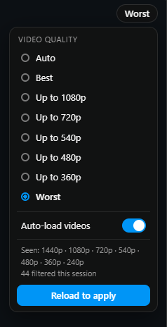
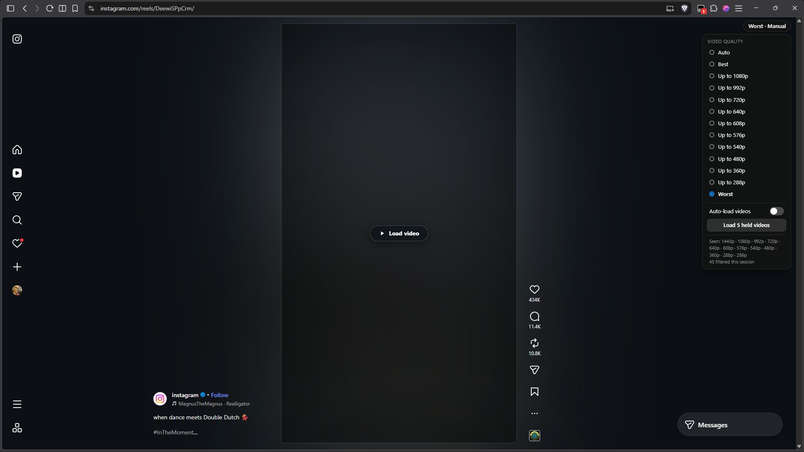

<div align="center">

# Instagram Web Data Saver

**Cut data use on Instagram web.** Pick a video quality, and make videos load only when you click them.

[](https://github.com/zyl-fx/Instagram-web-data-saver/releases/latest/download/Instagram-Web-Data-Saver.user.js)
[](https://greasyfork.org/en/scripts/600943-instagram-web-data-saver)
[](https://github.com/zyl-fx/Instagram-web-data-saver/releases/latest)
[](LICENSE)

</div>

Instagram's website has no data saver. This userscript adds one: a small widget in the top-right corner that controls video quality and click-to-load, like the data saver on Twitter/X.

<p align="center">
  
  &nbsp;&nbsp;
  
</p>


## Features

- **Video quality switcher.** Auto, Best, Worst, plus resolution caps (for example *Up to 720p*) when Instagram offers enough resolutions.
- **Auto really means Auto.** In Auto the script changes nothing, so Instagram keeps adapting quality to your connection.
- **Click to load.** Turn off *Auto-load videos* and every video waits behind a **Load video** button.
- **Works in the feed, Reels and Stories.**
- **Private.** No network requests of its own, no analytics, no accounts. Settings stay in your browser.

## Install

You need a userscript manager, and on Chrome-based browsers you must also switch on one setting for it. Skipping that setting is the most common reason it "does nothing".

### 1. Install a userscript manager

- **Chrome, Edge, Brave, Opera, Vivaldi:** [Tampermonkey](https://www.tampermonkey.net/) (or [Violentmonkey](https://violentmonkey.github.io/)) from your browser's extension store
- **Firefox:** [Tampermonkey](https://addons.mozilla.org/firefox/addon/tampermonkey/) or [Violentmonkey](https://addons.mozilla.org/firefox/addon/violentmonkey/) from Firefox Add-ons

### 2. Allow user scripts (Chrome, Edge, Brave and other Chromium browsers)

Chromium browsers require an extra permission before any userscript manager can run scripts.

**Chrome / Edge 138 or newer**

1. Go to `chrome://extensions` (Edge: `edge://extensions`).
2. Find **Tampermonkey** (or Violentmonkey) and click **Details**.
3. Turn on **Allow User Scripts**.

**Older versions**

1. Go to `chrome://extensions` (Edge: `edge://extensions`).
2. Turn on **Developer mode** (top-right corner).

**Firefox:** nothing to do, skip this step.

> Tampermonkey's [FAQ](https://www.tampermonkey.net/faq.php?q=Q209) describes the same requirement.

### 3. Install the script

Click the green **Install** button at the top of this page, or open this link:

```
https://github.com/zyl-fx/Instagram-web-data-saver/releases/latest/download/Instagram-Web-Data-Saver.user.js
```

Your userscript manager opens an installation page. Click **Install**. This link always installs the latest [release](https://github.com/zyl-fx/Instagram-web-data-saver/releases).

If you see plain code instead, the manager isn't installed, is disabled, or step 2 was skipped. Do step 2, then open the link again.

**Manual install:** open the Tampermonkey dashboard, click the **+** tab, paste the contents of [`Instagram-Web-Data-Saver.user.js`](Instagram-Web-Data-Saver.user.js), and save with **Ctrl+S**.

Prefer Greasy Fork? You can also install it from [Greasy Fork](https://greasyfork.org/en/scripts/600943-instagram-web-data-saver).

### 4. Use it

Open [instagram.com](https://www.instagram.com/). A small label appears in the top-right corner. Hover over it (or click it) to open the panel.

## Using the widget

- **Auto** (default): Instagram chooses the quality and adapts to your connection. Nothing is modified.
- **Best**: Always the highest quality available.
- **Up to 720p** *(etc.)*: Never above that resolution, but still adapts below it. Shown only after at least three different resolutions have been seen.
- **Worst**: Always the lowest quality available. Least data.
- **Auto-load videos**: On: videos load as usual. Off: click **Load video** on each one.
- **Load N held videos**: Appears while auto-load is off and videos are waiting. Loads all of them at once.

- Quality changes apply to videos loaded afterwards. Press **Reload to apply** to change videos already on screen.
- The auto-load switch takes effect immediately. Turning it back on releases every held video.
- The panel lists the resolutions it has seen (for example *Seen: 1080p · 720p*), so the options always match what Instagram actually serves.

### About the quality options

Instagram gives each video a ladder of renditions, usually several bitrates at 720p, often one 1080p rendition, and sometimes a 360p one. The set varies from video to video, so the widget builds its list from what it has actually seen. With only two resolutions you get Auto, Best and Worst.

*Worst* picks the lowest bitrate at the lowest resolution, so it can look soft even when the resolution is still 720p.

## Troubleshooting

- **The widget doesn't appear:** Check step 2 (**Allow User Scripts** or **Developer mode**), make sure the script is enabled in your manager's dashboard, then reload Instagram.
- **Changing quality seems to do nothing:** Press **Reload to apply**. Already-loaded videos keep their quality.
- **A video is stuck with auto-load off:** Open the widget and press **Load N held videos**, or turn **Auto-load videos** back on.
- **Another script or extension interferes:** Disable other Instagram userscripts and try again.

To collect debug output, run this in the browser console (F12), then reload the page:

```js
localStorage.setItem('igds:debug', '1')
```

Look for lines starting with `[IGDS]`. Turn logging off with `localStorage.removeItem('igds:debug')`.

Found a bug? [Open an issue](https://github.com/zyl-fx/Instagram-web-data-saver/issues) with your browser, your userscript manager and its version, and the `[IGDS]` lines.

## Compatibility

- **Chrome, Edge, Brave (desktop):** Supported. Needs **Allow User Scripts** or **Developer mode**.
- **Firefox (desktop):** Supported.
- **Safari, mobile browsers:** Not tested. In Safari the install link may download the file instead of opening an install page.

Instagram changes its site often, so something may stop working without warning. Please report it.

## How it works

- **Quality.** Instagram sends the player a manifest listing the available renditions. The script removes the ones you don't want before the player reads it, so the player can't pick them.
- **Click to load.** With auto-load off, a video's source assignment is held back until you click, so the player never starts streaming.

## Privacy

The script makes no network requests of its own and collects nothing. Your settings and the list of resolutions seen are stored in your browser's `localStorage` on instagram.com.

## Limitations

- Photos are not held back by click-to-load. They are small next to video and can't be intercepted reliably from a userscript.
- Small video thumbnails (profile and explore grids) are held back without a button. Open the post or reel and use its **Load video** button.
- Instagram may prefetch some data in the background that this script cannot see.
- Once you load a video, that video element stays loaded. If Instagram reuses it for the next item, the next item may load automatically.

## Contributing

Bug reports, ideas and pull requests are welcome. See [CONTRIBUTING.md](CONTRIBUTING.md).

## Contributors

Thanks to everyone who has helped.

<a href="https://github.com/zyl-fx/Instagram-web-data-saver/graphs/contributors">
  
</a>

## License

[MIT](LICENSE). Made by [Zyl](https://github.com/zyl-fx).

*Not affiliated with, endorsed by, or connected to Instagram or Meta.*
